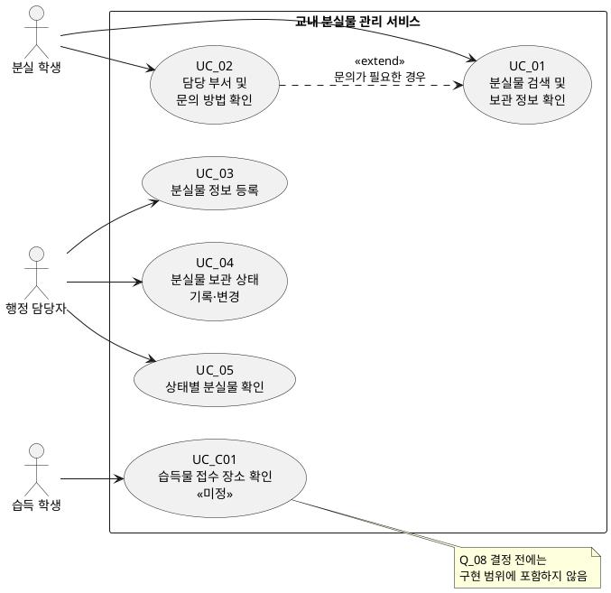

# 소프트웨어 요구사항 명세서 v0.1 — 분실물 서비스

| 항목 | 내용 |
|---|---|
| 문서 버전 | v0.1 |
| 기준 문서 | `docs/고객 요구사항.md` |
| 문서 목적 | 고객 요구를 개발·시험 가능한 기능, 품질 요구사항, 제약, 정책, 업무 규칙과 유스케이스로 구체화한다. |
| 대상 서비스 | 교내 분실물 관리 서비스 |
| 작성 상태 | 초안 |

## 1. 요구사항 판정 기준

| 판정 | 의미 | 적용 원칙 |
|---|---|---|
| 확정 | 고객 요구사항 원문에서 포함·제외·제약이 명시된 내용 | 구현 및 검증 기준으로 사용한다. |
| 질문 | 원문에서 미정이거나 개발 전에 고객·운영 책임자의 결정이 필요한 내용 | 답변 전에는 임의 구현 기준으로 확정하지 않는다. |
| 제안 | 개발·검증 가능성을 높이기 위해 본 명세서에서 보완한 동작이나 수치 | 고객 승인 후 확정 요구사항으로 전환한다. |

## 2. 고객 요구사항 분석

### 2.1 고객 요구 요약

| 고객 요구 ID | 사용자 의도 | 원문 근거 | 판정 |
|---|---|---|---|
| NEEDS_1 | 분실 학생이 방문 전에 물품의 보관 여부와 위치를 확인한다. | S1, SC1 | 확정. 검색 조건·공개 항목은 질문 |
| NEEDS_2 | 행정 담당자가 조회에 필요한 물품 정보를 등록한다. | S2, SC2 | 확정. 필수 입력·권한은 질문 |
| NEEDS_3 | 행정 담당자가 `보관 중`과 `인도 완료` 상태를 기록하고 구분한다. | S2, SC3 | 확정. 처리·정정 조건은 질문 |
| NEEDS_4 | 분실 학생이 담당 부서와 문의 방법을 확인한다. | S5, SC6 | 확정. 표시 내용은 질문 |
| NEEDS_5 | 습득 학생이 물건을 맡길 장소를 확인한다. | S3, SC4 | 프로그램 포함 여부 질문 |
| NEEDS_6 | 공개 정보 범위를 제한하고 개인 휴대전화 번호를 공개하지 않는다. | S4, SC8, C_1 | 개인 번호 비공개는 확정. 나머지는 질문 |
| NEEDS_7 | 행정 담당자의 등록 부담을 줄인다. | S2 | 목표는 확정. 측정 방법·수치는 질문 |

### 2.2 개발 범위와 공통 제약 요약

| 범위·제약 ID | 내용 | 원문 판단 |
|---|---|---|
| SC1 | 분실물 보관 여부와 위치 조회 | 포함 |
| SC2 | 분실물 정보 등록 | 포함 |
| SC3 | 보관 중·인도 완료 상태 구분 | 포함 |
| SC4 | 습득물을 맡길 장소 안내 | 미정 |
| SC5 | 사진을 올려 비슷한 분실물 조회 | 제외 |
| SC6 | 보관 담당자에게 문의할 방법 안내 | 포함 |
| SC7 | 사진 매칭 결과 자동 알림 | 제외 |
| SC8 | 개인 휴대전화 번호 공개 | 제외 |
| C_1 | 가상 데이터 사용, 실제 개인정보와 학교 인증 연동 제외 | 공통 제약 |

## 3. 공통 정책과 업무 규칙

### 3.1 공통 정책

| 정책 ID | 정책 | 판정 | 원문 근거 | 검증 방법 |
|---|---|---|---|---|
| Pol_01 | 개발·시험·시연에는 가상 데이터만 사용한다. | 확정 | C_1 | 사용 데이터 표본과 배포 자료 검사 |
| Pol_02 | 실제 개인정보를 입력·저장·조회 대상으로 사용하지 않는다. | 확정 | C_1 | 데이터 저장소와 시험 데이터 검사 |
| Pol_03 | v0.1에서는 학교 인증 시스템과 연동하지 않는다. | 확정 | C_1 | 시스템 구성과 외부 연동 목록 검토 |
| Pol_04 | 개인 휴대전화 번호를 사용자 화면에 공개하지 않는다. | 확정 | NEEDS_6, SC8, S4 | 전체 조회·문의 화면 검사 |
| Pol_05 | 문의 수단으로 승인된 담당 부서와 공식 문의 방법을 사용한다. | 확정 | NEEDS_4, NEEDS_6, SC6, SC8 | 승인 정보와 표시 정보 대조 |
| Pol_06 | 사진 업로드와 유사 물품 비교 기능은 v0.1에서 제외한다. | 확정 | SC5 | 화면·API·기능 목록 검토 |
| Pol_07 | 사진 매칭 결과 자동 알림 기능은 v0.1에서 제외한다. | 확정 | SC7 | 알림 기능과 외부 발송 연동 부재 확인 |

### 3.2 업무 규칙

| 규칙 ID | 업무 규칙 | 판정 | 원문 근거 | 검증 방법 |
|---|---|---|---|---|
| BR_01 | 물품 상태는 `보관 중`과 `인도 완료`로 구분한다. | 확정 | NEEDS_3, SC3 | 상태 값·화면·상태별 조회 시험 |
| BR_02 | 물품 등록과 보관·인도 상태 관리는 행정 담당자의 업무이다. | 확정 | S2, NEEDS_2, NEEDS_3 | 액터 권한과 기능 연결 검토 |
| BR_03 | 습득 학생의 현재 요구는 직접 등록이 아니라 물건을 맡길 장소 확인이다. | 확정 | S3, NEEDS_5 | 액터·유스케이스 연결 검토 |
| BR_04 | 등록이 성공한 물품만 학생 조회 대상에 반영한다. | 제안 | SC2의 등록·조회 목적에서 도출 | 등록 성공·실패 시험 |
| BR_05 | 상태 변경이 성공하면 학생과 담당자의 후속 조회에 동일한 상태를 표시한다. | 제안 | NEEDS_3의 기록·구분 목적에서 도출 | 변경 후 다중 화면 일관성 시험 |

### 3.3 미정 질문

| 질문 ID | 질문 | 관련 항목 | 결정 주체(후보) |
|---|---|---|---|
| Q_01 | 분실물 검색 조건과 필수 조건, 일치 판단 기준은 무엇인가? | NEEDS_1, UC_01, FR_01 | 행정 담당자, 학생회 |
| Q_02 | 공개할 물품 정보와 보관 위치의 상세 수준은 어디까지인가? 인도 완료 물품에도 위치를 표시하는가? | NEEDS_1, NEEDS_6, UC_01 | 정보보호 담당자, 운영 책임자 |
| Q_03 | 검색 결과나 문의 정보가 없을 때 어떤 대체 안내를 제공하는가? | UC_01, UC_02 | 행정 담당자, 운영 책임자 |
| Q_04 | 등록 필수 항목, 최초 상태, 중복 판단 기준과 임시 저장 필요 여부는 무엇인가? | NEEDS_2, UC_03, FR_05 | 행정 담당자, 정보보호 담당자 |
| Q_05 | 학교 인증 없이 행정 담당자 전용 기능의 접근을 어떻게 통제하는가? | UC_03~UC_05, Pol_03 | 운영 책임자 |
| Q_06 | 인도 완료 조건, 처리 역할, 오처리 정정 절차와 변경 이력 보관 여부는 무엇인가? | NEEDS_3, UC_04 | 운영 책임자, 행정 담당자 |
| Q_07 | 표시할 담당 부서명과 공식 문의 방법은 무엇인가? | NEEDS_4, UC_02 | 운영 책임자, 행정 담당자 |
| Q_08 | 습득물 접수 장소 안내를 v0.1에 포함하는가? 포함 시 장소 정보는 누가 관리하는가? | NEEDS_5, UC_C01 | 운영 책임자, 행정 담당자 |
| Q_09 | 서비스 운영과 정책 승인 책임 주체는 누구인가? | 운영 전반 | 학교 |
| Q_10 | 등록 부담의 기준값·측정 방법과 개선 목표를 승인할 것인가? | NEEDS_7, NFR_01 | 행정 담당자, 운영 책임자 |
| Q_11 | 목표 응답 시간, 동시 사용자 수와 서비스 제공 시간은 무엇인가? | 성능·가용성 | 운영 책임자 |
| Q_12 | 지원할 브라우저·기기와 접근성 기준은 무엇인가? | 호환성·접근성 | 운영 책임자, 학생회 |

## 4. 사용자 목표와 액터

### 4.1 사용자 목표

| 목표 ID | 사용자 | 하고 싶은 일 | 얻는 가치 | 판정 |
|---|---|---|---|---|
| UG_01 | 분실 학생 | 방문 전에 물품의 보관 여부와 위치를 확인한다. | 불필요한 행정실 방문을 줄인다. | 확정 |
| UG_02 | 분실 학생 | 담당 부서와 공식 문의 방법을 확인한다. | 적절한 문의 경로를 선택한다. | 확정 |
| UG_03 | 행정 담당자 | 습득 물품 정보를 빠르게 등록한다. | 반복 문의와 등록 부담을 줄인다. | 확정, 목표 수치는 질문 |
| UG_04 | 행정 담당자 | 물품 상태를 기록·변경한다. | 보관 물품과 인도 완료 물품의 혼선을 방지한다. | 확정 |
| UG_05 | 행정 담당자 | 상태별 물품을 확인한다. | 현재 관리 대상과 처리 완료 대상을 구분한다. | 확정 |
| UG_C01 | 습득 학생 | 물건을 맡길 장소를 확인한다. | 습득물을 적절한 부서에 전달한다. | 포함 여부 질문 |

### 4.2 액터 목록

| 액터 ID | 액터 | 유형 | 역할과 목표 | 원문 근거 | 판정 |
|---|---|---|---|---|---|
| ACT_01 | 분실 학생 | 주 액터 | 분실물의 보관 여부·위치와 문의 방법을 확인한다. | S1, NEEDS_1, NEEDS_4 | 확정 |
| ACT_02 | 행정 담당자 | 주 액터 | 물품을 등록하고 보관·인도 상태를 관리한다. | S2, NEEDS_2, NEEDS_3 | 확정 |
| ACT_C01 | 습득 학생 | 후보 액터 | 습득물 접수 장소를 확인한다. | S3, NEEDS_5, SC4 | 범위 질문 |
| STK_01 | 정보보호 담당자 | 이해관계자 | 공개 정보 범위를 검토한다. 직접 시스템 기능은 미정이다. | S4 | 액터 아님 |
| STK_02 | 학생회 | 이해관계자 | 학생 의견을 전달한다. 직접 시스템 기능은 미정이다. | S5 | 액터 아님 |
| STK_03 | 서비스 운영 책임자 | 이해관계자 | 운영 정책과 책임을 결정한다. 실제 담당 주체는 미정이다. | 이해관계자 표 | 액터 여부 질문 |

## 5. 유스케이스 모델

### 5.1 유스케이스 목록

| UC ID | UC 명 | 사용자 목표 | 주 액터 | 관련 고객 요구 | 판정 |
|---|---|---|---|---|---|
| [UC_01](#uc_01) | 분실물 검색 및 보관 정보 확인 | UG_01 | 분실 학생 | NEEDS_1, NEEDS_3, NEEDS_6 | 확정, 상세 질문 |
| [UC_02](#uc_02) | 담당 부서 및 문의 방법 확인 | UG_02 | 분실 학생 | NEEDS_4, NEEDS_6 | 확정, 상세 질문 |
| [UC_03](#uc_03) | 분실물 정보 등록 | UG_03 | 행정 담당자 | NEEDS_2, NEEDS_7 | 확정, 상세 질문 |
| [UC_04](#uc_04) | 분실물 보관 상태 기록·변경 | UG_04 | 행정 담당자 | NEEDS_3 | 확정, 상세 질문 |
| [UC_05](#uc_05) | 상태별 분실물 확인 | UG_05 | 행정 담당자 | NEEDS_3 | 확정 |
| [UC_C01](#uc_c01) | 습득물 접수 장소 확인 | UG_C01 | 습득 학생 | NEEDS_5 | 범위 질문 |

### 5.2 유스케이스 다이어그램

### 5.3 액터-유스케이스 연결표

| 액터 | 연결 UC | 관계 | 사용 목적 | 판정 |
|---|---|---|---|---|
| 분실 학생 | [UC_01](#uc_01) | 수행 | 물품 검색, 보관 여부와 위치 확인 | 확정 |
| 분실 학생 | [UC_02](#uc_02) | 수행 | 담당 부서와 문의 방법 확인 | 확정 |
| 행정 담당자 | [UC_03](#uc_03) | 수행 | 분실물 정보 등록 | 확정 |
| 행정 담당자 | [UC_04](#uc_04) | 수행 | 보관·인도 상태 기록과 변경 | 확정 |
| 행정 담당자 | [UC_05](#uc_05) | 수행 | 상태별 물품 확인 | 확정 |
| 습득 학생 | [UC_C01](#uc_c01) | 후보 수행 | 습득물 접수 장소 확인 | Q_08 질문 |
| UC_02 | UC_01 | `<<extend>>` | UC_01 수행 중 문의가 필요한 경우 확장 | 제안 |

## 6. 유스케이스(UC) 명세

### 6.1 UC_01 분실물 검색 및 보관 정보 확인

| 항목 | 내용 |
|---|---|
| ID / UC 명 | UC_01 / 분실물 검색 및 보관 정보 확인 |
| 목표 | 분실 학생이 방문 전에 물품의 보관 여부와 위치를 확인해 불필요한 방문을 줄인다. |
| 액터 | 분실 학생 |
| 출처 | S1, SC1, NEEDS_1, NEEDS_3, NEEDS_6 |
| 판정 | UC 포함은 확정. 검색 조건과 공개 항목은 Q_01·Q_02 질문 |

| 조건 | 내용 |
|---|---|
| 사전 조건 | 서비스가 조회 가능한 상태이다. 물품 등록 여부와 관계없이 조회를 시작할 수 있다. |
| 트리거 | 분실 학생이 잃어버린 물건의 보관 정보를 확인하려 한다. |
| 성공 사후 조건 | 일치하는 물품의 `보관 중` 또는 `인도 완료` 상태와 공개 가능한 위치가 표시된다. |
| 취소 사후 조건 | 조회가 종료되며 물품 데이터는 변경되지 않는다. |
| 실패 시 보존 조건 | 조회 실패 시 기존 물품 정보와 상태를 변경하지 않으며 실제 개인정보를 노출하지 않는다. |

| 기본 단계 | 액터/시스템 | 흐름 | 판정 |
|---:|---|---|---|
| 1 | 분실 학생 | 분실물 조회를 시작한다. | 확정 |
| 2 | 분실 학생 | 검색 조건을 입력하거나 선택한다. | 조건은 Q_01 질문 |
| 3 | 시스템 | 등록된 물품 중 조건에 맞는 물품을 검색한다. | 확정 |
| 4 | 시스템 | 일치한 물품과 상태를 구분해 표시한다. | 확정 |
| 5 | 분실 학생 | 찾는 물품을 확인한다. | 확정 |
| 6 | 시스템 | 승인된 범위의 보관 위치를 표시한다. | 범위는 Q_02 질문 |

| 대안 ID | 분기 지점 | 조건 | 대응 | 복귀/종료 | 판정 |
|---|---:|---|---|---|---|
| UC_01-A1 | 3 | 일치하는 물품이 없음 | 결과 없음 안내와 UC_02 이동 수단을 제공한다. | UC_02 또는 종료 | 제안, Q_03 |
| UC_01-A2 | 4 | 물품이 `인도 완료` 상태임 | 인도 완료 상태를 표시한다. 위치 표시 여부는 Q_02에서 정한다. | 5로 복귀 | 질문 |

| 예외 ID | 분기 지점 | 조건 | 대응 | 복귀/종료 | 판정 |
|---|---:|---|---|---|---|
| UC_01-E1 | 2 | 검색 조건이 누락되거나 유효하지 않음 | 잘못된 조건을 알리고 다시 입력하도록 한다. | 2로 복귀 | 제안, Q_01 |
| UC_01-E2 | 3 | 조회 처리 실패 | 실패 사실을 알리고 기존 데이터를 변경하지 않는다. | 재시도 또는 종료 | 제안 |

### 6.2 UC_02 담당 부서 및 문의 방법 확인

| 항목 | 내용 |
|---|---|
| ID / UC 명 | UC_02 / 담당 부서 및 문의 방법 확인 |
| 목표 | 분실 학생이 공식 문의 경로를 확인해 적절한 담당 부서에 문의한다. |
| 액터 | 분실 학생 |
| 출처 | S4, S5, SC6, SC8, NEEDS_4, NEEDS_6 |
| 판정 | UC 포함과 개인 번호 비공개는 확정. 표시 내용은 Q_07 질문 |

| 조건 | 내용 |
|---|---|
| 사전 조건 | 분실 학생이 서비스의 조회 화면에 접근할 수 있다. |
| 트리거 | 조회 결과에 관해 담당 부서에 문의할 필요가 있다. |
| 성공 사후 조건 | 승인된 담당 부서와 공식 문의 방법이 표시된다. |
| 취소 사후 조건 | 문의 정보 확인을 종료하고 이전 화면으로 돌아가며 데이터는 변경되지 않는다. |
| 실패 시 보존 조건 | 승인되지 않은 연락처나 개인 휴대전화 번호를 대신 표시하지 않는다. |

| 기본 단계 | 액터/시스템 | 흐름 | 판정 |
|---:|---|---|---|
| 1 | 분실 학생 | 담당 부서와 문의 방법 확인을 요청한다. | 확정 |
| 2 | 시스템 | 승인된 담당 부서를 표시한다. | 상세는 Q_07 질문 |
| 3 | 시스템 | 승인된 공식 문의 방법을 표시하고 개인 휴대전화 번호는 표시하지 않는다. | 확정 |
| 4 | 분실 학생 | 문의 정보를 확인한다. | 확정 |

| 대안 ID | 분기 지점 | 조건 | 대응 | 복귀/종료 | 판정 |
|---|---:|---|---|---|---|
| UC_02-A1 | 2 | 물품별 담당 부서를 정할 수 없음 | 서비스 대표 담당 부서와 공식 문의 방법을 표시한다. | 4로 합류 | 제안, Q_03·Q_07 |

| 예외 ID | 분기 지점 | 조건 | 대응 | 복귀/종료 | 판정 |
|---|---:|---|---|---|---|
| UC_02-E1 | 2 | 문의 정보가 없음 | 표시 불가 사실과 승인된 대체 안내를 제공한다. | 종료 | 제안, Q_03 |

### 6.3 UC_03 분실물 정보 등록

| 항목 | 내용 |
|---|---|
| ID / UC 명 | UC_03 / 분실물 정보 등록 |
| 목표 | 행정 담당자가 습득 물품을 빠르게 등록해 학생 조회를 가능하게 하고 반복 문의와 등록 부담을 줄인다. |
| 액터 | 행정 담당자 |
| 출처 | S2, SC2, NEEDS_2, NEEDS_7 |
| 판정 | 등록 주체와 기능은 확정. 필수 항목·접근 통제·목표 수치는 Q_04·Q_05·Q_10 질문 |

| 조건 | 내용 |
|---|---|
| 사전 조건 | 행정 담당자가 합의된 운영 방식에 따라 등록 기능에 접근할 수 있다. |
| 트리거 | 행정 담당자가 보관할 습득 물품을 접수한다. |
| 성공 사후 조건 | 유효한 물품 정보가 저장되고 학생 조회 대상에 반영된다. |
| 취소 사후 조건 | 신규 등록을 완료하지 않는다. 임시 저장 여부는 Q_04에서 정한다. |
| 실패 시 보존 조건 | 불완전한 레코드를 조회 대상에 남기지 않고 실제 개인정보를 저장하지 않는다. |

| 기본 단계 | 액터/시스템 | 흐름 | 판정 |
|---:|---|---|---|
| 1 | 행정 담당자 | 분실물 등록을 시작한다. | 확정 |
| 2 | 시스템 | 등록 입력 항목을 제공한다. | 필수 항목은 Q_04 질문 |
| 3 | 행정 담당자 | 물품과 보관 정보를 입력한다. | 확정 |
| 4 | 시스템 | 필수 입력과 값의 유효성을 확인한다. | 제안 |
| 5 | 시스템 | 결정된 규칙에 따라 최초 상태를 설정한다. | Q_04 질문 |
| 6 | 시스템 | 물품 정보를 저장하고 완료 결과를 표시한다. | 확정 |
| 7 | 시스템 | 등록 물품을 학생 조회 대상에 반영한다. | 제안, BR_04 |

| 대안 ID | 분기 지점 | 조건 | 대응 | 복귀/종료 | 판정 |
|---|---:|---|---|---|---|
| UC_03-A1 | 4 | 필수 값이 누락되거나 유효하지 않음 | 저장하지 않고 수정할 항목을 표시한다. | 3으로 복귀 | 제안 |
| UC_03-A2 | 3~5 | 담당자가 등록을 취소함 | 등록을 종료한다. 임시 저장 여부는 Q_04에서 정한다. | 종료 | 질문 |

| 예외 ID | 분기 지점 | 조건 | 대응 | 복귀/종료 | 판정 |
|---|---:|---|---|---|---|
| UC_03-E1 | 6 | 저장 처리 실패 | 실패를 알리고 조회 대상에 반영하지 않는다. | 재시도 또는 종료 | 제안 |

### 6.4 UC_04 분실물 보관 상태 기록·변경

| 항목 | 내용 |
|---|---|
| ID / UC 명 | UC_04 / 분실물 보관 상태 기록·변경 |
| 목표 | 행정 담당자가 실제 보관·인도 상태를 기록해 현재 보관 물품과 처리 완료 물품의 혼선을 방지한다. |
| 액터 | 행정 담당자 |
| 출처 | S2, SC3, NEEDS_3 |
| 판정 | 상태 구분·변경은 확정. 처리·정정 규칙은 Q_05·Q_06 질문 |

| 조건 | 내용 |
|---|---|
| 사전 조건 | 대상 물품이 등록되어 있고 담당자가 상태 관리 기능에 접근할 수 있다. |
| 트리거 | 물품이 인도되었거나 기존 상태를 정정할 필요가 있다. |
| 성공 사후 조건 | 대상 상태가 저장되고 후속 조회에 동일하게 반영된다. |
| 취소 사후 조건 | 상태 변경이 적용되지 않고 기존 상태를 유지한다. |
| 실패 시 보존 조건 | 저장 실패 시 기존 상태를 유지한다. |

| 기본 단계 | 액터/시스템 | 흐름 | 판정 |
|---:|---|---|---|
| 1 | 행정 담당자 | 상태를 관리할 물품을 찾는다. | 확정 |
| 2 | 시스템 | 물품의 현재 정보와 상태를 표시한다. | 확정 |
| 3 | 행정 담당자 | `보관 중` 또는 `인도 완료`를 선택한다. | 확정 |
| 4 | 시스템 | 변경 내용을 확인할 수 있도록 표시한다. | 제안 |
| 5 | 행정 담당자 | 상태 변경을 확정한다. | 확정 |
| 6 | 시스템 | 상태를 저장하고 후속 조회에 반영한다. | 제안, BR_05 |

| 대안 ID | 분기 지점 | 조건 | 대응 | 복귀/종료 | 판정 |
|---|---:|---|---|---|---|
| UC_04-A1 | 4~5 | 담당자가 변경을 취소함 | 변경을 폐기하고 기존 상태를 유지한다. | 종료 | 제안 |
| UC_04-A2 | 시작 전 | 오처리 상태를 정정해야 함 | 권한이 있는 담당자가 정정 절차에 따라 상태를 선택한다. | 2로 합류 | 질문, Q_06 |

| 예외 ID | 분기 지점 | 조건 | 대응 | 복귀/종료 | 판정 |
|---|---:|---|---|---|---|
| UC_04-E1 | 6 | 상태 저장 실패 | 실패를 알리고 기존 상태를 유지한다. | 재시도 또는 종료 | 제안 |

### 6.5 UC_05 상태별 분실물 확인

| 항목 | 내용 |
|---|---|
| ID / UC 명 | UC_05 / 상태별 분실물 확인 |
| 목표 | 행정 담당자가 보관 중 물품과 인도 완료 물품을 구분해 현재 관리 대상을 확인한다. |
| 액터 | 행정 담당자 |
| 출처 | S2, SC3, NEEDS_3 |
| 판정 | 확정. 접근 통제와 비정상 상태 처리 방식은 Q_05·Q_06 질문 |

| 조건 | 내용 |
|---|---|
| 사전 조건 | 하나 이상의 물품이 등록되어 있고 담당자가 조회 기능에 접근할 수 있다. |
| 트리거 | 담당자가 보관 또는 인도 현황을 확인하려 한다. |
| 성공 사후 조건 | 물품이 `보관 중`과 `인도 완료` 상태로 구분되어 표시된다. |
| 취소 사후 조건 | 상태별 확인을 종료하며 시스템 데이터는 변경되지 않는다. |
| 실패 시 보존 조건 | 기존 물품 정보와 상태를 변경하지 않는다. |

| 기본 단계 | 액터/시스템 | 흐름 | 판정 |
|---:|---|---|---|
| 1 | 행정 담당자 | 상태별 분실물 확인을 시작한다. | 확정 |
| 2 | 시스템 | 등록 물품과 현재 상태를 조회한다. | 확정 |
| 3 | 시스템 | `보관 중`과 `인도 완료` 물품을 구분해 표시한다. | 확정 |
| 4 | 행정 담당자 | 원하는 상태의 목록을 확인한다. | 확정 |

| 대안 ID | 분기 지점 | 조건 | 대응 | 복귀/종료 | 판정 |
|---|---:|---|---|---|---|
| UC_05-A1 | 3 | 선택 상태에 해당하는 물품이 없음 | 해당 상태의 물품이 없음을 표시한다. | 4 후 종료 | 제안 |

| 예외 ID | 분기 지점 | 조건 | 대응 | 복귀/종료 | 판정 |
|---|---:|---|---|---|---|
| UC_05-E1 | 2 | 물품 상태가 비어 있거나 허용 값이 아님 | 정상 목록과 혼합하지 않고 오류를 알린다. | 종료 | 제안, Q_06 |

### 6.6 UC_C01 습득물 접수 장소 확인 — 후보

| 항목 | 내용 |
|---|---|
| ID / UC 명 | UC_C01 / 습득물 접수 장소 확인 |
| 목표 | 습득 학생이 주운 물건을 맡길 장소를 확인해 적절한 부서에 전달한다. |
| 액터 | 습득 학생 |
| 출처 | S3, SC4, NEEDS_5 |
| 판정 | Q_08 결정 전에는 구현 범위에 포함하지 않는 질문 항목 |

| 조건 | 내용 |
|---|---|
| 사전 조건 | 안내할 접수 장소와 관리 주체가 결정되어 있어야 한다. |
| 트리거 | 습득 학생이 주운 물건을 제출하려 한다. |
| 성공 사후 조건 | 접수 장소와 이용 안내가 표시된다. |
| 취소 사후 조건 | 안내 확인을 종료하며 시스템 데이터는 변경되지 않는다. |
| 실패 시 보존 조건 | 임의의 장소를 안내하지 않고 데이터는 변경하지 않는다. |

| 기본 단계 | 액터/시스템 | 흐름 | 판정 |
|---:|---|---|---|
| 1 | 습득 학생 | 접수 장소 확인을 요청한다. | 질문 |
| 2 | 시스템 | 운영 중인 접수 장소와 이용 안내를 표시한다. | 질문 |
| 3 | 습득 학생 | 접수 장소를 확인한다. | 질문 |

| 대안 ID | 분기 지점 | 조건 | 대응 | 복귀/종료 | 판정 |
|---|---:|---|---|---|---|
| UC_C01-A1 | 2 | 운영 시간이나 물품 종류에 따라 장소가 다름 | 조건에 맞는 접수 장소를 표시한다. | 3으로 합류 | 질문, Q_08 |

| 예외 ID | 분기 지점 | 조건 | 대응 | 복귀/종료 | 판정 |
|---|---:|---|---|---|---|
| UC_C01-E1 | 2 | 안내 가능한 접수 장소가 없음 | 안내 불가 사실과 승인된 대체 문의 방법을 표시한다. | 종료 | 질문, Q_08 |

## 7. 기능 요구사항

유스케이스 단계가 상세 동작을 정의하므로 이 표는 구현·시험 단위와 연결 관계를 요약한다.

| 요구사항 ID | 요구사항 | 연결 UC/단계 | 판정 | 검증 기준 |
|---|---|---|---|---|
| FR_01 | 시스템은 학생이 결정된 검색 조건으로 등록 물품을 조회할 수 있도록 해야 한다. | UC_01 1~3 | 확정, 조건은 Q_01 | 조건에 맞는 등록 물품이 결과에 포함된다. |
| FR_02 | 시스템은 조회된 물품의 `보관 중` 또는 `인도 완료` 상태를 표시해야 한다. | UC_01 4 | 확정 | 각 결과에 허용된 상태 하나가 표시된다. |
| FR_03 | 시스템은 승인된 범위의 보관 위치를 표시해야 한다. | UC_01 6 | 확정, 범위는 Q_02 | 승인된 위치가 표시되고 비승인 정보는 표시되지 않는다. |
| FR_04 | 시스템은 승인된 담당 부서와 공식 문의 방법을 표시하고 개인 휴대전화 번호를 표시하지 않아야 한다. | UC_02 1~4 | 확정, 표시 내용은 Q_07 | 문의 정보가 표시되고 개인 번호 노출은 0건이다. |
| FR_05 | 시스템은 행정 담당자가 유효한 물품 정보를 등록하고 조회 대상에 반영할 수 있도록 해야 한다. | UC_03 1~7 | 확정, 필수 항목은 Q_04 | 성공 등록은 조회되며 실패·취소 등록은 조회되지 않는다. |
| FR_06 | 시스템은 행정 담당자가 물품 상태를 `보관 중` 또는 `인도 완료`로 기록·변경할 수 있도록 해야 한다. | UC_04 1~6 | 확정, 권한·정정은 Q_05·Q_06 | 변경 성공 시 새 상태, 실패·취소 시 기존 상태가 유지된다. |
| FR_07 | 시스템은 행정 담당자가 물품을 상태별로 구분해 확인할 수 있도록 해야 한다. | UC_05 1~4 | 확정 | 보관 중 목록과 인도 완료 목록이 명확히 구분된다. |

## 8. 비기능 요구사항

### 8.1 품질 요구사항

| 요구사항 ID | 품질 특성 | 요구사항과 목표 | 판정 | 검증 방법 |
|---|---|---|---|---|
| NFR_01 | 업무 효율성 | 동일한 대표 등록 시나리오에서 시스템 사용 후 평균 등록 소요 시간을 현행 기준 대비 20% 이상 줄인다. 기준값과 최종 목표는 Q_10에서 승인한다. | 제안 | 동일 담당자·시나리오로 도입 전후 시간을 측정해 평균 비교 |
| NFR_02 | 정보보호 | 모든 사용자 화면에서 실제 개인정보와 개인 휴대전화 번호의 노출 건수는 0이어야 한다. | 확정 | 화면·응답·시험 데이터 전수 또는 자동 검사 |
| NFR_03 | 데이터 일관성 | 각 물품은 `보관 중`과 `인도 완료` 중 정확히 하나의 상태를 가지며 모든 조회에서 동일한 상태를 표시해야 한다. | 확정 취지, 상세 동작 제안 | 등록·변경·실패·동시 조회 시나리오 시험 |
| NFR_06 | 사용성 | 대표 분실 학생의 90% 이상이 별도 도움 없이 3분 이내에 보관 여부·위치·문의 방법을 확인한다. 목표 수치는 승인 전 제안이다. | 제안 | 대표 사용자 과업 시험으로 성공률과 완료 시간 측정 |

### 8.2 제약 조건

| 요구사항 ID | 제약 | 판정 | 검증 방법 |
|---|---|---|---|
| NFR_04 | 개발·시험·시연에는 가상 데이터만 사용하고 실제 개인정보를 저장하지 않는다. | 확정 | 데이터 저장소, 로그와 배포 자료 검사 |
| NFR_05 | v0.1은 학교 인증 시스템과 연동하지 않는다. | 확정 | 구성·의존성·네트워크 연동 목록 검토 |

> 성능, 가용성, 호환성 및 접근성의 수치 기준은 원문에 없다. Q_11과 Q_12의 답변 전에는 임의의 확정 요구사항을 추가하지 않는다.

## 9. 요구사항 추적표

표 안의 UC·FR·NFR·정책 ID를 선택하면 이 문서의 해당 정의로 이동한다.

| RTM ID | 고객 요구/범위 | 연결 유스케이스 | 기능 요구사항 | 비기능 요구사항 | 정책·규칙 | 추적 상태 |
|---|---|---|---|---|---|---|
| RTM_01 | [NEEDS_1](#needs_1), [SC1](#sc1) | [UC_01](#uc_01) | [FR_01](#fr_01), [FR_02](#fr_02), [FR_03](#fr_03) | [NFR_06](#nfr_06) | [Pol_02](#pol_02) | 부분 충족: Q_01·Q_02 필요 |
| RTM_02 | [NEEDS_2](#needs_2), [SC2](#sc2) | [UC_03](#uc_03) | [FR_05](#fr_05) | [NFR_01](#nfr_01), [NFR_04](#nfr_04) | [Pol_01](#pol_01), [Pol_02](#pol_02), [BR_02](#br_02), [BR_04](#br_04) | 부분 충족: Q_04·Q_05·Q_10 필요 |
| RTM_03 | [NEEDS_3](#needs_3), [SC3](#sc3) | [UC_04](#uc_04), [UC_05](#uc_05) | [FR_06](#fr_06), [FR_07](#fr_07) | [NFR_03](#nfr_03) | [BR_01](#br_01), [BR_02](#br_02), [BR_05](#br_05) | 부분 충족: Q_05·Q_06 필요 |
| RTM_04 | [NEEDS_4](#needs_4), [SC6](#sc6) | [UC_02](#uc_02) | [FR_04](#fr_04) | [NFR_02](#nfr_02), [NFR_06](#nfr_06) | [Pol_04](#pol_04), [Pol_05](#pol_05) | 부분 충족: Q_03·Q_07 필요 |
| RTM_05 | [NEEDS_5](#needs_5), [SC4](#sc4) | [UC_C01](#uc_c01) | 없음 | 없음 | [BR_03](#br_03) | 미정: Q_08 필요 |
| RTM_06 | [NEEDS_6](#needs_6), [SC8](#sc8) | [UC_01](#uc_01), [UC_02](#uc_02) | [FR_03](#fr_03), [FR_04](#fr_04) | [NFR_02](#nfr_02) | [Pol_02](#pol_02), [Pol_04](#pol_04), [Pol_05](#pol_05) | 부분 충족: Q_02·Q_07 필요 |
| RTM_07 | [NEEDS_7](#needs_7) | [UC_03](#uc_03) | [FR_05](#fr_05) | [NFR_01](#nfr_01) | 없음 | 부분 충족: Q_10 승인 필요 |
| RTM_08 | [SC5](#sc5) | 해당 없음 | 해당 없음 | 해당 없음 | [Pol_06](#pol_06) | 충족: 범위 제외 |
| RTM_09 | [SC7](#sc7) | 해당 없음 | 해당 없음 | 해당 없음 | [Pol_07](#pol_07) | 충족: 범위 제외 |
| RTM_10 | [C_1](#c_1) — 가상 데이터·실제 개인정보 제외 | [UC_03](#uc_03) | [FR_05](#fr_05) | [NFR_02](#nfr_02), [NFR_04](#nfr_04) | [Pol_01](#pol_01), [Pol_02](#pol_02) | 충족 |
| RTM_11 | [C_1](#c_1) — 학교 인증 연동 제외 | [UC_03](#uc_03), [UC_04](#uc_04), [UC_05](#uc_05) | [FR_05](#fr_05), [FR_06](#fr_06), [FR_07](#fr_07) | [NFR_05](#nfr_05) | [Pol_03](#pol_03) | 제약 충족, Q_05 필요 |

## 10. 범위 및 검토 요약

| 구분 | 내용 |
|---|---|
| 확정 포함 | 분실물 검색, 보관 여부·위치 확인, 공식 문의 정보 확인, 행정 담당자의 물품 등록, 보관·인도 상태 기록·변경·구분 |
| 범위 질문 | 습득물 접수 장소 안내 |
| 확정 제외 | 사진 업로드·유사도 비교, 사진 매칭 자동 알림, 개인 휴대전화 번호 공개, 실제 개인정보 사용, 학교 인증 연동 |
| 승인 필요한 제안 | 등록시간 20% 단축, 사용자 과업 3분·성공률 90%, 검증 가능한 오류·취소 처리와 데이터 보존 동작 |
| 개발 전 우선 질문 | Q_01 검색 조건, Q_02 공개 정보, Q_04 등록 항목, Q_05 접근 통제, Q_06 상태 처리·정정, Q_07 문의 정보, Q_08 후보 범위 |
